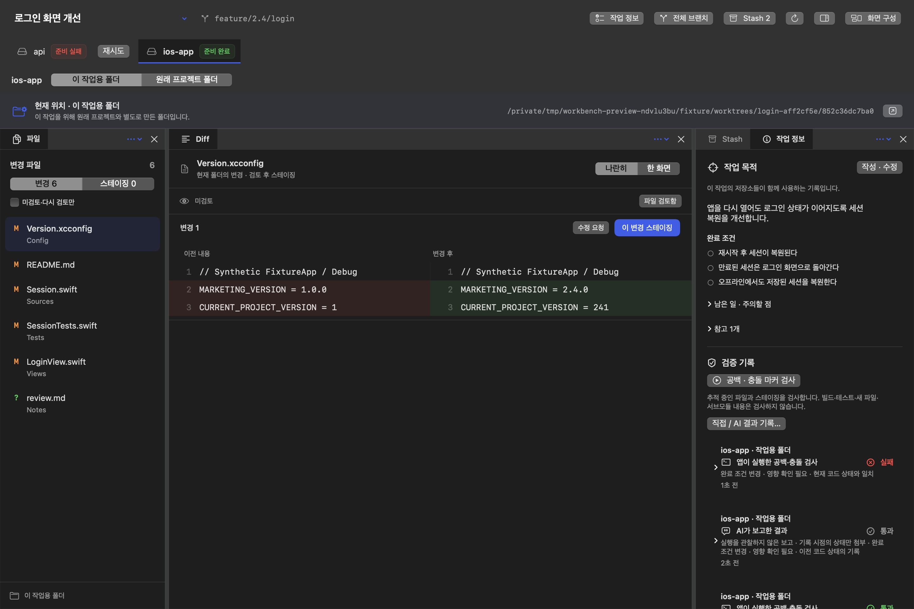
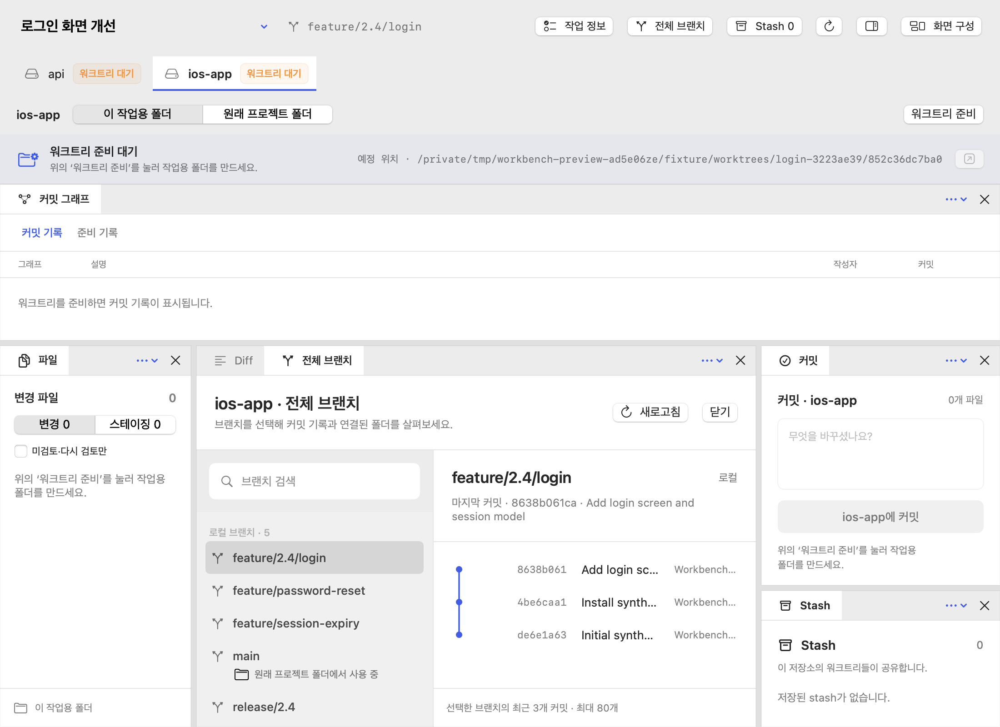

# Agent Git Workbench

**여러 저장소와 워크트리 사이에서 코드 검토를 이어가는 네이티브 macOS Git 앱.**

A native macOS Git workbench for worktrees, multiple repositories, and review alongside AI tools.

> 초기 개발 단계입니다. SwiftUI/AppKit 앱과 Rust 로컬 엔진이 동작하지만, 정식 릴리스·배포 설치기는 아직 없습니다. 제품명과 라이선스도 미확정입니다.



*실제 SwiftUI/AppKit 화면을 합성 Git 저장소로 렌더링했습니다. 오른쪽의 앱 실행 검증과 AI 보고는 서로 다른 기록입니다.*

## 어떤 작업을 할 수 있나요?

설정된 여러 저장소에 작업 브랜치와 별도의 작업용 폴더(Git linked worktree)를 하나의 **Task**로 함께 준비하고, 변경을 저장소별로 검토·커밋합니다. 처음 연 프로젝트 폴더는 그대로 두며, 준비가 일부 실패해도 완료된 저장소의 결과는 유지합니다. 이 구성을 작업공간(workspace)이라고 부릅니다.

| 기능 | 현재 지원 범위 |
| --- | --- |
| 워크트리 중심 작업 | 설정된 저장소들의 브랜치 생성, 작업용 폴더 준비, 저장소별 상태·실패 확인과 명시적 재시도 |
| 코드 검토와 커밋 | 변경 파일, 나란히/한 화면 Diff, 텍스트 hunk 단위 스테이징·해제, staged 변경 커밋 |
| 브랜치와 Stash | 로컬·원격 추적 브랜치 검색과 최근 기록(마지막 fetch 기준), 연결된 폴더 표시, Stash 파일·Diff 읽기 전용 조회 |
| 전환 상태 유지 | 같은 작업공간에서 파일·Diff·스크롤을 복원하고 Git 상태 재확인. 커밋 초안은 앱 세션 동안, 개인 검토·스크롤은 현재 작업공간 세션 동안 유지 |
| 자유로운 화면 구성 | 파일·Diff·그래프·커밋·Stash·작업 정보·브랜치 pane(패널)의 분할, 이동, 탭 결합, 숨김과 배치 저장 |
| AI와 함께 검토 | 선택한 hunk의 수정 요청문과 인수인계 초안 복사, 작업 목적·완료 조건·검증 결과 기록 |

앱이 AI 모델을 직접 호출하지는 않습니다. 복사한 요청문을 Claude·Codex·Grok 등 사용 중인 도구에 전달하는 방식입니다. AI나 사람이 적은 결과는 **보고**로 보관하며, 앱이 실제 실행한 검사 결과와 구분합니다.

<details>
<summary>전체 브랜치 화면 보기</summary>



브랜치를 선택하면 기록을 조회합니다. 이 동작으로 checkout하지 않습니다. 위 화면은 작업용 폴더를 아직 준비하지 않은 합성 예제입니다.

</details>

## 빌드하고 실행하기

필요한 도구는 macOS, Swift 6 이상을 포함한 Xcode, Rust/Cargo, Git, Python 3입니다. 검증에는 전체 Xcode를 사용했으며 Command Line Tools만 설치한 환경은 검증하지 않았습니다. Rust 코드는 edition 2024를 사용합니다. SwiftPM 배포 대상은 macOS 14 이상이며, 현재 검증 환경은 macOS 27.0.1 / Swift 6.4 / Rust 1.97.1 / Git 2.54.0 / Python 3.9.6입니다. macOS 14에서의 실행은 아직 검증하지 않았습니다.

```sh
git clone https://github.com/ictechgy/agent-git-workbench.git
cd agent-git-workbench
python3 scripts/build_macos.py
open "build/macos/Agent Git Workbench.app"
```

빌드 스크립트가 Rust 엔진과 Swift 앱을 함께 빌드해 개발용 서명으로 묶습니다. Node·npm·웹 서버는 필요 없습니다. 앱은 번들에 포함된 엔진을 자동으로 실행하므로, 연결 주소나 Unix 소켓 경로를 입력할 필요가 없습니다.

1. 시작 화면에서 **예제로 먼저 둘러보기**를 선택합니다. 앱 전용 위치에 합성 저장소 두 개와 준비 작업을 만듭니다.
2. 저장소를 골라 **이 작업용 폴더 / 원래 프로젝트 폴더**와 실제 경로를 확인합니다.
3. 변경을 읽고 **이 변경 스테이징**을 누른 뒤, 커밋 pane에서 메시지를 작성합니다.
4. 자신의 프로젝트는 **저장소 열기…**로 선택합니다. 폴더를 여는 것만으로 파일·HEAD·index를 변경하거나 준비 스크립트를 신뢰하지 않습니다.

예제 생성은 합성 저장소에만 적용됩니다. **저장소 열기…**로 연 프로젝트는 현재 단일 저장소 작업공간으로 등록되며 준비 recipe가 없습니다. 다중 저장소와 recipe 구성은 내장 예제와 [CLI 예제](docs/cli.md)에서 확인할 수 있습니다. GUI에서 이 구성을 만들거나 편집하거나, 별도 설정 파일을 가져오는 기능은 아직 없습니다.

**저장소 열기…**로 등록한 프로젝트에서 새 작업을 실행하면 원래 저장소에 `feature/<task_slug>` 브랜치 ref가 생깁니다. `materialize`는 앱 데이터 위치 아래에 별도 작업용 폴더를 만들고, `branch_only`는 ref만 만든 뒤 폴더를 준비 대기로 둡니다. 일반 등록은 최초 등록 시점의 현재 브랜치를 기본 기준으로 설정합니다(detached HEAD이면 첫 로컬 브랜치, 없으면 `main`). 실행 전 계획 화면의 기준 브랜치·OID를 확인하세요.

## 작업을 이어가는 방법

- **위치부터 확인:** Task의 작업용 폴더와 원래 프로젝트 폴더를 전환할 수 있습니다. 준비 대기·실패 상태를 성공으로 표시하지 않습니다.
- **검토 상태 유지:** 같은 작업공간에서 폴더를 오가면 최근 파일·Diff·스크롤 위치를 복원합니다. 저장한 작업 목적·완료 조건·검증 기록은 앱 기록(journal)에 남습니다. 커밋 초안은 현재 앱 세션에 한정하고, 개인 검토·스크롤 기록은 다른 작업공간으로 전환하거나 앱을 종료하면 사라집니다.
- **직접 배치:** pane 제목을 끌어 다른 pane의 좌·우·위·아래에 나누거나 중앙에 탭으로 합칩니다. 배치는 다음 실행에도 복원합니다. 상단 **화면 구성**에서 숨긴 pane을 다시 열 수 있습니다.
- **검증과 보고 구분:** **공백 · 충돌 마커 검사**는 추적 파일과 스테이징의 `git diff --check`, Git 충돌·진행 상태를 검사합니다. 빌드·테스트 결과가 아니며 추적되지 않은 새 파일·서브모듈 내용은 검사 범위 밖입니다.

`⌘O` 저장소 열기 · `⌘N` 새 작업 · `⌘R` 갱신 · `⌘↩` 커밋 · `⌘⌥L` 화면 구성.

설정·최근 프로젝트·작업 기록(journal)은 `~/Library/Application Support/AgentGitWorkbench`에 저장합니다. 최근 메뉴는 최대 30개이며 기존 작업공간 등록은 별도로 찾습니다. 이 복원은 정상적으로 읽을 수 있는 등록을 기준으로 합니다.

## 현재 제한

- **지원 전:** fetch·pull·push 등 원격 동기화, 브랜치 checkout·이름 변경·삭제(생성은 Task 준비로만 가능), 변경 되돌리기(discard), merge·rebase·충돌 해결 UI, history rewriting, 임의 행 스테이징, Stash 적용·삭제, 자동 AI 실행·CI·빌드·병합, Windows/Linux GUI.
- **Git 실행 정책:** fsmonitor·hook·외부 서명 프로그램을 실행하지 않습니다. 앱에서 만든 커밋에는 Git hook이 적용되지 않으며 서명도 하지 않습니다(`commit.gpgsign=true`인 경우 포함). 외부 clean/smudge/process 명령이 설정되면 상태·Diff 조회와 작업 준비·쓰기가 거부됩니다. 해당 저장소가 LFS를 쓰지 않아도 전역 LFS 필터 명령이 있으면 같은 제한을 받습니다. 저장소 안에서 `git config --show-origin --get-regexp '^filter\..*\.(clean|smudge|process)$'`로 값이 있는 항목을 확인할 수 있습니다.
- **준비와 쓰기:** 원래 checkout을 바꾸지 않고 작업용 폴더를 준비합니다. source snapshot이나 신뢰 기준이 바뀌면 중단하며, 조용히 재계획하거나 reset/clean으로 복구하지 않습니다. Recipe는 OS 보안 sandbox가 아닙니다.
- **표시와 자원:** 그래프·브랜치 기록은 최근 최대 80개 커밋, Diff 표시는 5,000줄·512 KiB로 제한합니다. 대형 저장소의 속도·메모리·에너지는 아직 계측하지 않았습니다.
- **개발 단계 UX:** 일부 조회 실패·응답 유실 안내와 준비 버튼의 상태 정합성에 남은 문제가 있습니다. 이미 엔진에서 시작한 읽기는 클라이언트가 취소해도 계속될 수 있습니다.
- **배포:** 현재 `.app`은 개발용 ad-hoc 서명입니다. notarization·설치기·OS 입력 및 VoiceOver 검증은 완료하지 않았습니다.

자세한 범위와 알려진 문제는 [현재 제한](docs/limitations.md)을 확인하세요.

## 개발과 검증

```sh
cargo test --workspace
cargo clippy --workspace --all-targets -- -D warnings
swift test --package-path apps/macos
```

위 환경의 개발자 로컬 실행과 업로드 대상 파일만 복사한 별도 사본에서 **Rust 62개·Swift 51개 테스트**와 합성 저장소를 사용하는 CLI·네이티브 통신·앱 시작 시나리오를 통과했습니다(2026-10-22). CI는 아직 없으며 실제 사용자 저장소나 대형 저장소 성능을 검증한 수치도 아닙니다.

- [개발 환경·검증 명령](docs/development.md)
- [구조와 실행 경계](docs/architecture.md)
- [CLI·workspace·recipe 예제](docs/cli.md)
- [현재 제한과 알려진 문제](docs/limitations.md)

라이선스는 아직 정하지 않았습니다. 현재 Cargo 메타데이터는 `UNLICENSED`입니다.
