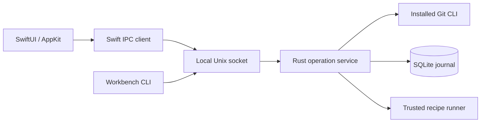

# 구조와 실행 경계

SwiftUI/AppKit 앱과 CLI는 같은 Rust operation service를 호출합니다. Git 상태와 변경의 기준은 설치된 Git CLI이며, SQLite는 작업·실행·검증 기록을 보관합니다.

## Task와 폴더

Task는 설정된 여러 저장소에 같은 작업 목적을 연결하는 앱 메타데이터입니다. Git의 부모·자식 commit 관계가 아닙니다.

- **원래 프로젝트 폴더:** 처음 연 checkout입니다.
- **이 작업용 폴더:** Task 준비 과정에서 별도로 만든 linked worktree입니다.
- **branch-only:** 브랜치 ref만 만들고 폴더는 준비 대기로 둡니다.
- **materialize:** 별도 worktree와 설정된 recipe를 준비합니다.

부분 실패는 저장소별로 남깁니다. 재시도는 기존 operation에서 재개하며 완료된 저장소를 다시 준비하지 않습니다. 저장소 간 원자적 rollback은 제공하지 않습니다.

## 계획·신뢰·쓰기

계획은 base OID, 원래 source snapshot, recipe 계약과 신뢰 기준을 고정합니다. 실행 전에 이 기준을 다시 확인하며 외부 변경을 조용히 덮어쓰지 않습니다. 같은 idempotency key와 같은 plan은 같은 operation을 가리킵니다.

서비스가 mutation 잠금과 journal을 소유합니다. 준비 접수는 서비스당 실행·대기 합계 8개이며 Git mutation은 직렬화합니다. 용량 초과는 journal 변경 전에 거부하고, 취소한 worker의 자리는 실제 종료 후 반환합니다.

Task staging·commit은 해당 저장소의 Ready 상태와 현재 snapshot을 다시 확인합니다. 실패한 worktree를 읽을 수 있는 것과 쓰기 가능한 것은 별개입니다. Hunk staging은 현재 서버 diff를 기준으로 하며 임의 patch를 받지 않습니다.

Recipe 신뢰는 임의 shell 입력 허용과 다릅니다. 예제 생성 시 만든 fixture recipe만 예제에서 신뢰합니다. 일반 저장소를 여는 동작은 스크립트 실행 권한을 부여하지 않습니다. Runner 자체는 OS sandbox가 아닙니다.

## 화면과 엔진 수명

앱이 번들 엔진과 짧은 사용자 전용 Unix 소켓 경로를 준비합니다. 여러 앱 인스턴스는 workspace lease를 통해 같은 엔진을 사용할 수 있습니다. 종료 시에는 마지막 client와 진행 중 작업을 확인하는 `shutdown_if_idle`을 사용합니다.

화면의 요청에는 workspace·선택 폴더·generation 경계가 있습니다. 오래된 응답이 새 프로젝트에 게시되지 않도록 하며, 취소한 조회는 클라이언트 소켓 대기를 해제합니다. 이미 엔진에서 실행한 Git 읽기까지 취소하는 것은 아닙니다.

초안·개인 읽기 기록·레이아웃의 수명은 서로 다릅니다. 저장한 Task 목적과 검증 기록은 journal에 유지하고, 커밋 초안은 앱 세션, 개인 읽기 기록은 현재 workspace 세션에 한정합니다. 레이아웃 설정은 다음 실행에도 복원합니다.

## AI 결과의 출처

앱이 실행한 고정 검사는 관찰한 코드 상태와 완료 조건을 함께 기록합니다. 사람이 적거나 AI가 보고한 결과는 별도 reported evidence이며, 앱 실행 결과로 승격하지 않습니다. 인수인계·hunk 수정 요청은 사용자가 미리 보고 복사할 수 있는 텍스트입니다. 자동 AI 실행·전송·병합은 없습니다.

이전 기술 결정은 [로컬 엔진](adr/0001-local-operation-core.md), [네이티브 macOS](adr/0002-native-macos-and-design-c.md), [앱 소유 시작](adr/0003-app-owned-startup.md)에 남아 있습니다. 현재 범위는 [제한 목록](limitations.md)을 우선합니다.
